

<h1 align="center">PandaConquest</h1>

<b>Take Azeroth, one Outpost at a time. Gather, recruit, and lead your faction's war.</b>

Built for the <b>OctoWoW 1.12.1</b> client. Alliance and Horde, from level 5.

> [!IMPORTANT]
> ## Install
>
> PandaConquest needs two downloads: the **addon** and the **PandaConquest Companion** (Windows; Linux and macOS are planned). Without the companion, the conquest stays paused.
>
> **1. The addon**
>
> 1. [Download the latest PandaConquest release](https://github.com/Tom75VN/PandaConquest/releases/latest) (`pandaConquest-x.y.z.zip`).
> 2. Extract it into `Wow-Octo\Interface\AddOns\`.
> 3. Check that `pandaConquest.toc` sits directly inside the `pandaConquest` folder.
>
> **2. The companion**
>
> 1. [Download the latest PandaConquest Companion](https://github.com/Tom75VN/PandaConquest-Companion/releases/latest) (`PandaConquest-Companion-x.y.z-win-x64.zip`).
> 2. Extract it into your **`Wow-Octo` folder**, the one that holds `WoW.exe`. You get a `PandaConquest-Companion` folder and `PandaConquestLauncher.dll` next to `WoW.exe`.
> 3. Turn it on once, either way:
>    - in the **Octo launcher**, open the mods and tick `PandaConquestLauncher.dll`;
>    - or run `PandaConquest-Companion\PandaConquest.Companion.exe` once. Windows SmartScreen may ask for confirmation the first time: choose **More info**, then **Run anyway**.
>
> **3. Play**
>
> 1. Start the game from the **Octo launcher**, with **nampower** ticked in its mods.
> 2. Log in with a character of level 5 or more, then open PandaConquest with `/pc` or the minimap button.
>
> From now on the companion starts and stops with the game by itself. No account to create, no installer, no window to manage.

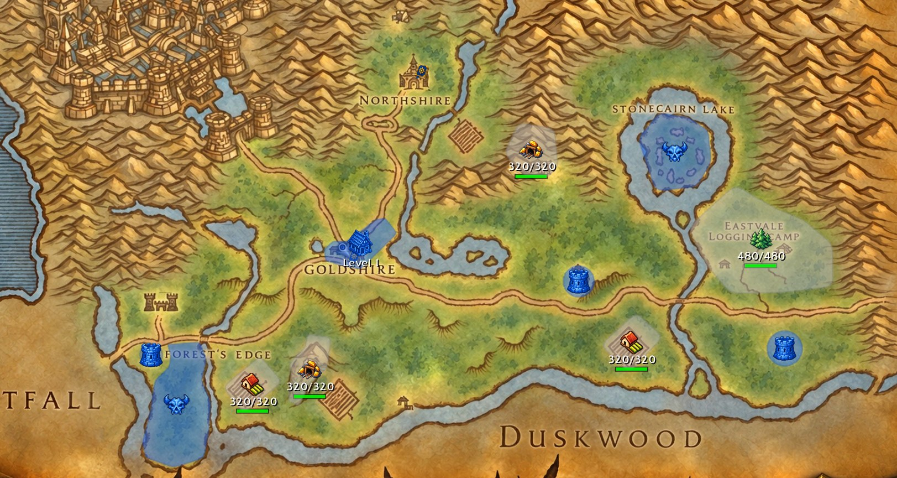

## Features at a glance

| | |
|---|---|
| [A war on the world map](#a-war-on-the-world-map) | 66 places across 6 zones, coloured by the faction that holds them |
| [Capture Outposts](#capture-outposts) | Stand your ground, PvP flag on, and watch the bar fill |
| [Hunting Grounds](#hunting-grounds) | Kill their creatures to win them for your faction |
| [Gather resources](#gather-resources) | Gold, wood and food from mines, forests and farms |
| [Raise an army](#raise-an-army) | Four units per faction, each with its own cost and strength |
| [Garrisons and Settlements](#garrisons-and-settlements) | Defend your places and level up your villages together |
| [Scout and attack](#scout-and-attack) | Find enemy places with a Knight, then march on them |
| [Conquer Settlements](#conquer-settlements) | The big prize: take the heart of a zone |
| [One window for the war](#one-window-for-the-war) | Territory, Resources, Army, Garrison, War and an illustrated Guide |

## A war on the world map

Every place of the conquest is drawn on your **world map** and **minimap**, in its faction's colour: blue for the Alliance, red for the Horde, grey while neutral.

- **6 zones** to fight over: Elwynn Forest, Westfall, Hillsbrad Foothills, Arathi Highlands, Durotar and The Barrens.
- **66 places**: Outposts, Settlements, Hunting Grounds, Gold Mines, Forests and Farms, each with its own icon.
- **Resource places** show what is left to gather; **Settlements** show their level.
- Zoom out to a continent and each zone gets a **capture bar** with the Alliance and Horde badges, so you see at a glance where the front lines are.

| Hillsbrad Foothills | The Barrens |
|---|---|
| 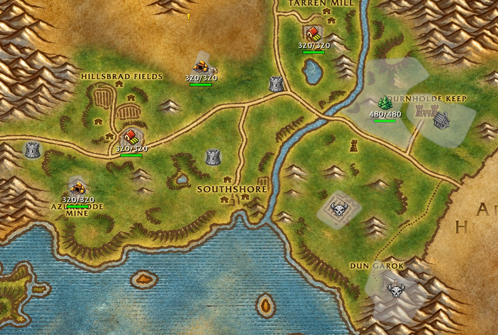 | 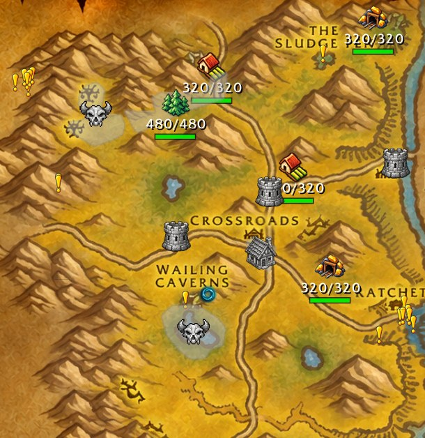 |

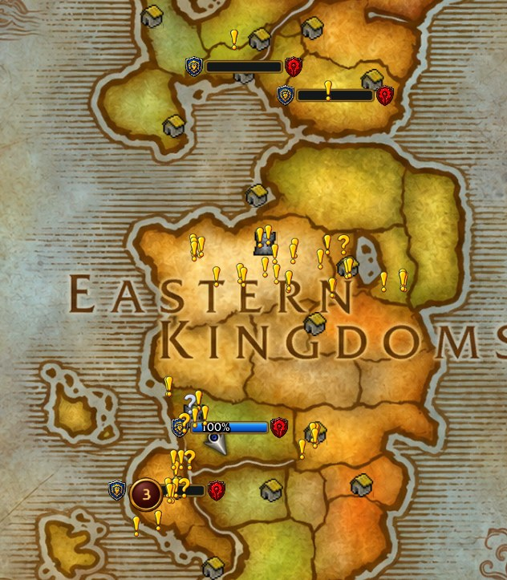 The continent view: one capture bar per zone

## Capture Outposts

Outposts are towers and camps held by a faction, or still neutral.

- Enter an enemy or neutral Outpost with your **PvP flag on** and stay inside until the bar is full.
- A capture takes **3 to 20 minutes**: the stronger the garrison inside, the longer it lasts.
- The **capture bar** shows the place, its owner, and how many players of each faction are there.
- The defenders are **warned** when one of their places is being captured: be ready for company.

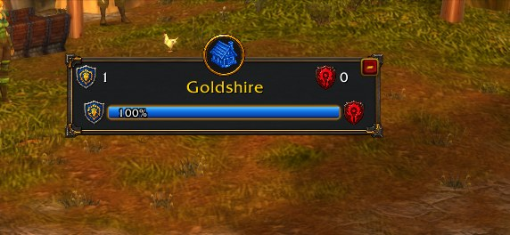

## Hunting Grounds

Some places are won by the sword, not by standing still: **kill the creatures listed for a Hunting Ground** to capture it for your faction. Levelling and conquest go hand in hand.

Hunting Grounds need **nampower**: start the game from the Octo launcher with nampower ticked.

## Gather resources

Three resources feed the war: **gold**, **wood** and **food**.

- Stand in a **Gold Mine**, **Forest** or **Farm** with your PvP flag on: you collect **+5 every 10 seconds**.
- Each place has a **stock shared by everyone**; it empties as players gather and refills slowly.
- The Resources tab shows what you carry, how much you can hold, and every place's stock.

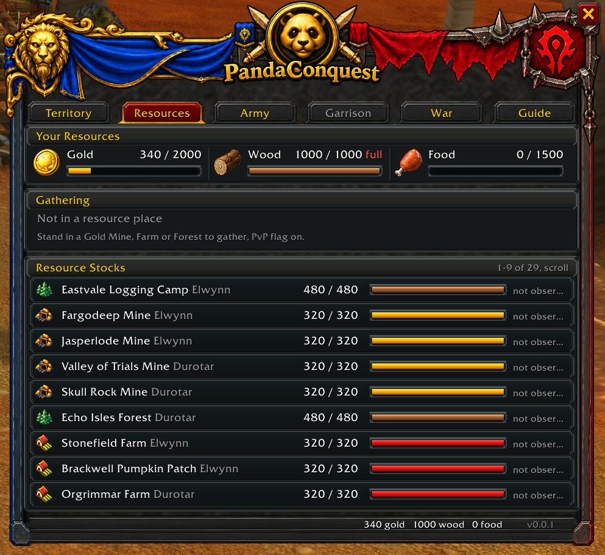

## Raise an army

Spend your resources on units, inside an **Outpost or Settlement your faction holds**.

- **Four units per faction**: three that fight, plus one scout that never fights.
- **Alliance**: Footman, Rifleman, Mortar Team, Knight. **Horde**: Grunt, Headhunter, Demolisher, Wolf Rider.
- Each unit shows its cost, its attack and defence, and how many you can still recruit.
- Your **reserve** holds up to **25 Unit Size**; costs are paid once, at recruitment.

| Alliance | Horde |
|---|---|
| 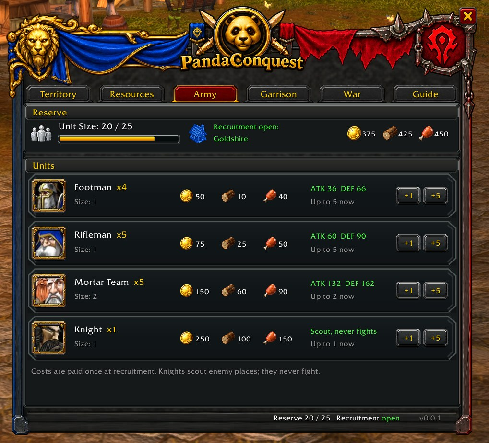 | 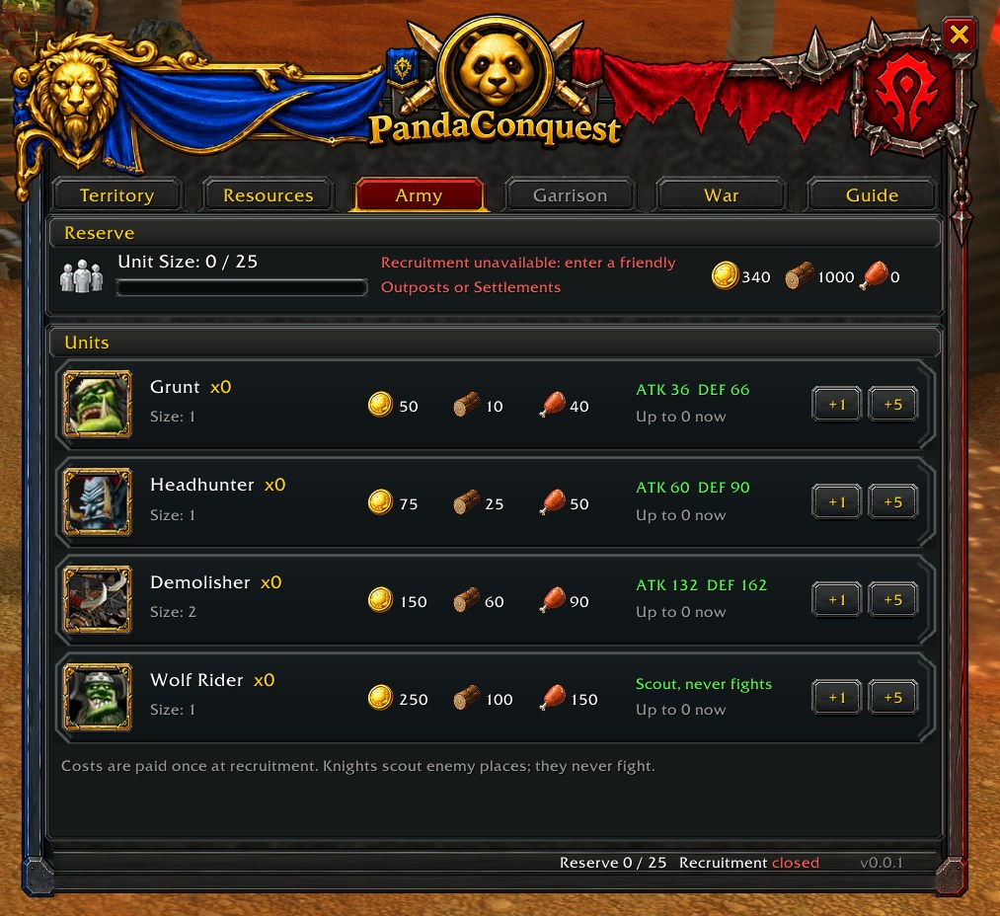 |

## Garrisons and Settlements

Your faction's places are only as strong as the troops inside.

- **Give units to a garrison** to defend an Outpost or a Settlement. A gift is final: it never comes back, it belongs to your faction now.
- **Settlements level up** from 1 to 3: everyone fills the **War Chest** with gold and wood, and each level makes room for a bigger garrison.
- The Garrison tab shows who holds the place, its level, its defence, the units inside and what is happening around it.

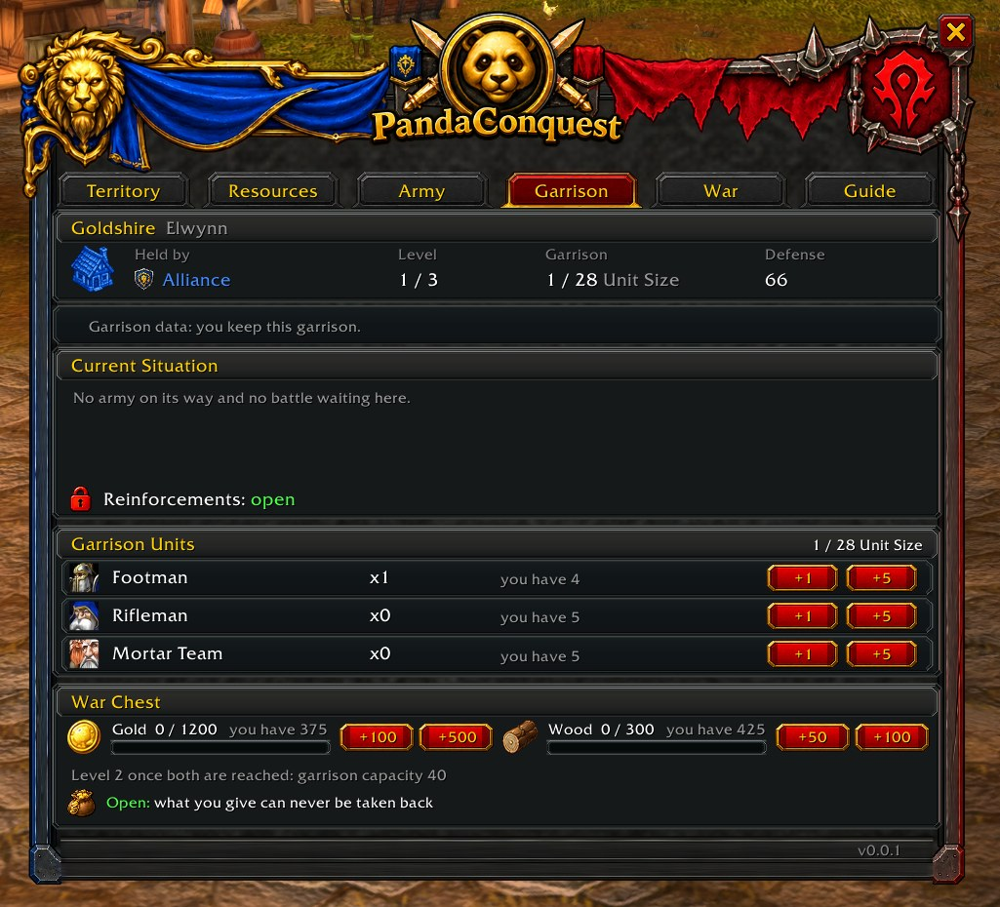

## Scout and attack

Take the war to the enemy from the War tab.

- **Scout**: send your Knight or Wolf Rider to an enemy place. Your whole faction can see it for **60 minutes**.
- **Attack**: pick a target you found, choose your units within your **Assault Capacity**, and send them. Armies take time to travel, and they never come back.
- **Your orders** list the scouts and armies on their way; **Threats to your faction** list the enemy armies marching on you.

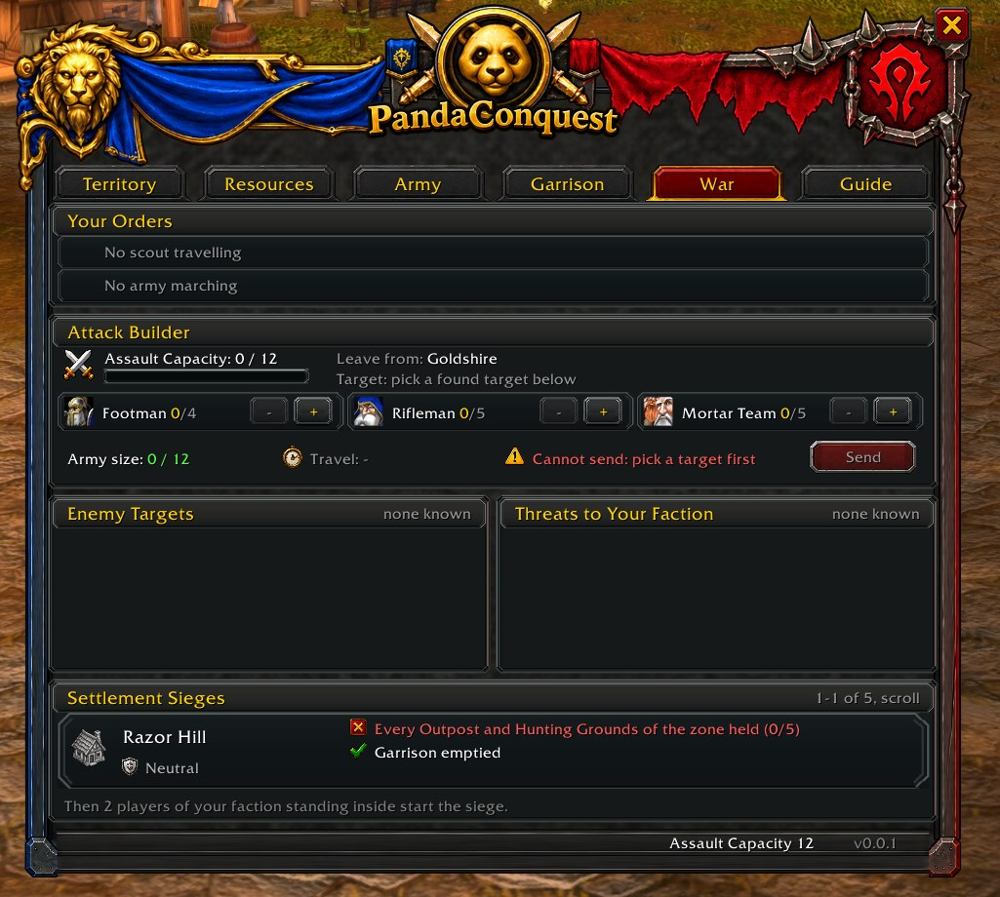

## Conquer Settlements

Settlements are the hearts of their zones, and the hardest places to take. To lay siege to one:

1. Hold **every Outpost and Hunting Ground** of its zone.
2. **Empty its garrison** with your attacks.
3. **Scout** it.
4. Then **2 players** of your faction stand inside for **10 minutes**.

The War tab tracks each step for every Settlement, so your faction always knows what is left to do.

## One window for the war

Open PandaConquest with `/pc` or the minimap button.

- **Territory**: the war balance between the factions, every place with its owner, and how fresh the news is.
- **Resources**, **Army**, **Garrison** and **War**: everything shown above.
- **Guide**: one illustrated card per step, from your first gathering to your first Settlement.

The war moves as players play: some news can arrive late, and the Territory tab shows how fresh it is.

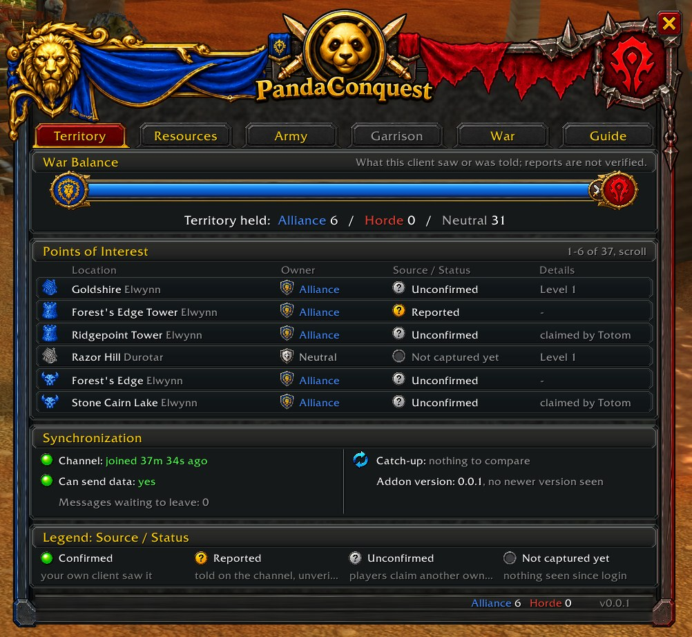

## Commands

| Command | What it does |
|---|---|
| `/pc` | Open or close the PandaConquest window |
| `/pc help` | List every command |
| `/pc where` | The place you are standing in |
| `/pc army` | Your reserve, unit costs, and whether you can recruit here |
| `/pc recruit <unit> [count]` | Recruit units in a place your faction holds |
| `/pc garrison` | Garrison, level and War Chest of the place you stand in |
| `/pc pledge <unit\|gold\|wood> [count] confirm` | Give units or resources to the place you stand in (final) |
| `/pc scout [place]` | Scouting status, or send your scout |
| `/pc attack [place footmen riflemen mortars]` | Armies and battles, or send an army |
| `/pc classic` | Open the simple text window |

## Good to know

- **Alpha**: PandaConquest is in early testing. Numbers and rules may still change.
- **Level 5**: below level 5, the conquest is hidden and you cannot take part.
- **Always launch from the Octo launcher** with nampower ticked; the companion follows the game on its own.
- **Updates**: keep the addon and the companion up to date. You are told when an update is needed.

## Coming next

- Achievements for your conquest feats: captures, battles, sieges.
- Leaderboards per character.
- More zones and places.

## Version

Current release: 0.0.1

[See the releases](https://github.com/Tom75VN/PandaConquest/releases).

## Acknowledgements

PandaConquest works hand in hand with [PandaMap](https://github.com/Tom75VN/PandaMap): its places follow the zoomed HD maps.

World of Warcraft is a trademark of Blizzard Entertainment. This project is not affiliated with or endorsed by Blizzard Entertainment.
